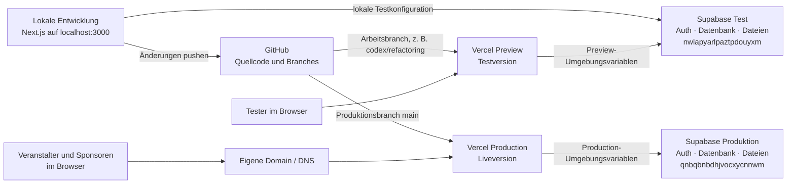
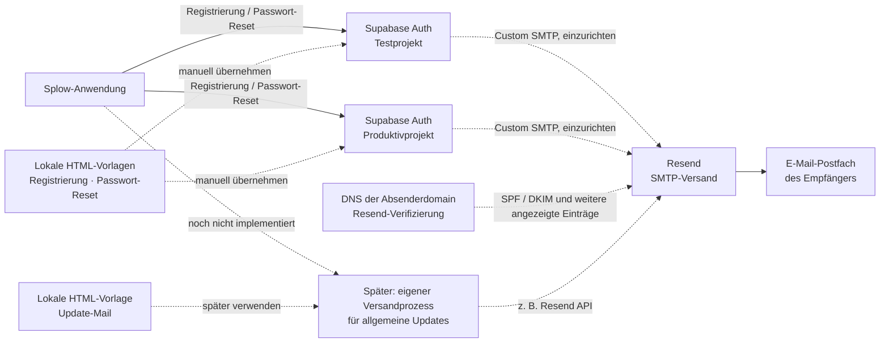

# Anwendungskarte: Splow

Für die aktuelle Karte der technischen Schnittstellen und ausgetauschten Daten siehe [`schnittstellen-landkarte.md`](./schnittstellen-landkarte.md).

Stand: 21. Oktober 2026. Diese Karte beschreibt die im Repository erkennbare Architektur und die in [`test-environments.md`](./test-environments.md) dokumentierte Zuordnung. Einstellungen in Vercel, Supabase, Resend und beim DNS-Anbieter wurden für diese Karte nicht in den jeweiligen Konten überprüft.

## 1. Entwicklung, Test und Livebetrieb

**Wichtig:** Test und Produktion sind eigenständige Supabase-Projekte. Die Next.js-Anwendung verwendet Supabase Auth für Anmeldungen, Postgres für Anwendungsdaten und Supabase Storage für Dateien. Browser und serverseitige API-Routen greifen je nach Funktion auf Supabase zu. Der Service-Role-Schlüssel darf nur serverseitig verwendet werden.

Der Weg von GitHub zur Vercel Preview und die Zuordnung der Umgebungsvariablen sind in der Projektdokumentation beschrieben. Ob die Vercel-Einstellungen aktuell genau so gesetzt sind, lässt sich aus dem Repository allein nicht bestätigen.

## 2. Auth-E-Mails und allgemeine Update-Mails

Die derzeit unversionierten lokalen Dateien unter `emails/` sind **Vorlagen**, keine aktive Verbindung zu Resend. Registrierung und Passwort-Reset werden von Supabase Auth ausgelöst; Resend kann sie nach Einrichtung als SMTP-Dienst zustellen. Im Testprojekt ist die E-Mail-Bestätigung laut Projektdokumentation derzeit deaktiviert; dort wird daher bei der Registrierung keine Bestätigungs-Mail versendet. Eine allgemeine Update-Mail benötigt einen eigenen Versandprozess in der Anwendung. Für Test und Produktion sind die SMTP-Einstellungen jeweils im passenden Supabase-Projekt vorzunehmen.

## Zuständigkeiten der Tools

| Tool | Aufgabe | Verbindung |
| --- | --- | --- |
| GitHub | Verwaltet Code und Branches | Liefert Änderungen an Vercel |
| Vercel | Betreibt die Next.js-Anwendung als Preview und Production | Verbindet jede Umgebung per Umgebungsvariablen mit dem passenden Supabase-Projekt |
| Supabase Test | Testanmeldung, Testdatenbank und Testdateien | Wird lokal und von der Preview verwendet, sofern die Preview entsprechend konfiguriert ist |
| Supabase Produktion | Liveanmeldung, Produktivdatenbank und Live-Dateien | Wird von der Liveversion verwendet |
| Resend | Zustellung von E-Mails | Als Custom SMTP für Supabase Auth vorgesehen; für allgemeine Updates wäre eine eigene API-Anbindung nötig |
| Domain / DNS | Öffentliche Adresse der Liveversion und Nachweis der Absenderdomain | Zeigt auf Vercel und enthält die von Resend geforderten DNS-Einträge |
| E-Mail-Postfach | Empfängt Antworten auf versendete E-Mails | Nur erforderlich, wenn unter der Absenderadresse Antworten empfangen werden sollen |
| OpenAI API | Später geplante KI-Funktionen | Im aktuellen Projekt nicht eingebunden |

**Legende:** Durchgezogene Pfeile zeigen die im Code oder in der Projektzuordnung beschriebenen Hauptwege. Gestrichelte Pfeile zeigen manuelle Einrichtung oder noch nicht implementierte Verbindungen.
