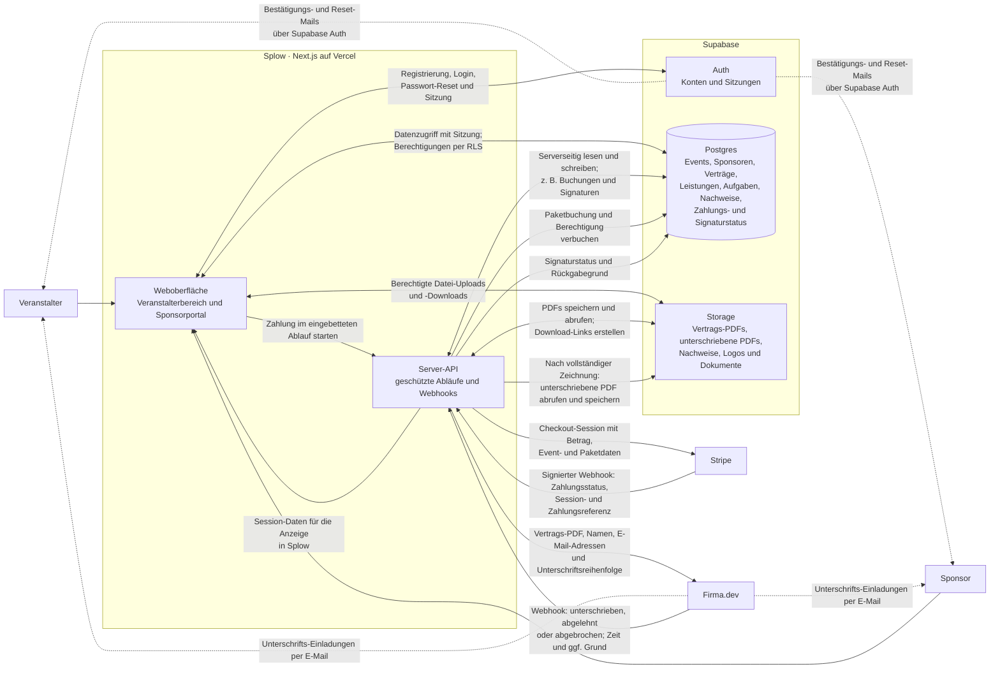

# Splow – Schnittstellen- und Datenflusskarte

Stand: 31. Oktober 2026. Diese Übersicht ist aus dem aktuellen Repository abgeleitet. Sie beschreibt die implementierten Flüsse im Anwendungscode; Einstellungen in GitHub, Vercel, Supabase, Stripe und Firma.dev wurden nicht live überprüft. Zugangsschlüssel und Geheimnisse sind nicht Bestandteil dieser Dokumentation.

## Was zwischen Splow und den Diensten fließt

- **Supabase Auth:** Splow nutzt Auth für Registrierung, Anmeldung und Passwort-Reset. Auth-Sitzungen autorisieren Datenzugriffe. Bestätigungs- und Reset-Mails werden von Supabase Auth ausgelöst; der konkrete Mailversand hängt von der Auth-/SMTP-Konfiguration des jeweiligen Supabase-Projekts ab.
- **Supabase Postgres:** Speichert unter anderem Event- und Organisationsdaten, Sponsoren, Verträge, Leistungsbausteine, Aufgaben, Nachweis-Metadaten sowie Zahlungs- und Signaturstatus. Browserzugriffe laufen mit der angemeldeten Sitzung und den Datenbankregeln (RLS); privilegierte serverseitige Abläufe verwenden den Admin-Zugriff nur auf dem Server.
- **Supabase Storage:** Speichert Vertragsdateien, die final unterschriebenen PDFs, Sponsor- und Eventdokumente, Logos und Nachweisdateien. Dateien werden über berechtigte Zugriffe oder zeitlich begrenzte Links bereitgestellt.
- **Stripe:** Beim Buchen eines Vertragspakets sendet Splow Betrag und Zuordnungsdaten wie Event und Paket an Stripe. Die Zahlung wird in Splow eingebettet angezeigt. Stripe meldet den bestätigten Zahlungsstatus über einen signierten Webhook zurück; Splow verbucht danach Paket und Berechtigung in Supabase. Kartendaten verarbeitet Stripe.
- **Firma.dev:** Splow übermittelt die Vertrags-PDF sowie Namen, E-Mail-Adressen und Reihenfolge der Unterzeichnenden. Firma sendet die Signaturanfragen. Webhooks melden Signaturen, Ablehnungen oder Abbrüche samt verfügbaren Zeitpunkten und Rückgabegrund. Nach erfolgreicher doppelter Zeichnung ruft Splow die finale PDF ab und speichert sie in Supabase Storage.

## Aktueller Hinweis zur Vertragszahlung

Im aktuellen Code ist die Paketzahlung über Stripe aktiv. Der eigenständige Endpunkt für eine Zahlung pro Vertrag meldet derzeit, dass die Vertragszeichnung inklusive ist, und startet keine separate Zahlung. Maßgeblich für die Freischaltung der Zeichnung ist die Event-Berechtigung.

## Sicherheit und Grenzen dieser Übersicht

- Stripe- und Firma-Webhook-Signaturen werden serverseitig geprüft.
- Private Schlüssel und privilegierte Supabase-Zugänge gehören ausschließlich in serverseitige Umgebungsvariablen.
- Die Zuordnung der tatsächlichen Preview- und Production-Variablen sowie die Anbieter-Einstellungen müssen in den jeweiligen Dashboards geprüft werden; aus dem Repository allein lässt sich ihr aktueller Livezustand nicht bestätigen.
- Diese Datei ist durch Git-Versionierung wiederherstellbar, solange die Git-Historie erhalten bleibt. Damit sie im Standardbranch nicht einfach entfernt oder überschrieben werden kann, braucht das GitHub-Repository passende Branch-Regeln (z. B. Schutz vor Löschung und Force-Push sowie vorgeschriebene Reviews). Repository-Administratoren können solche Regeln ändern.
